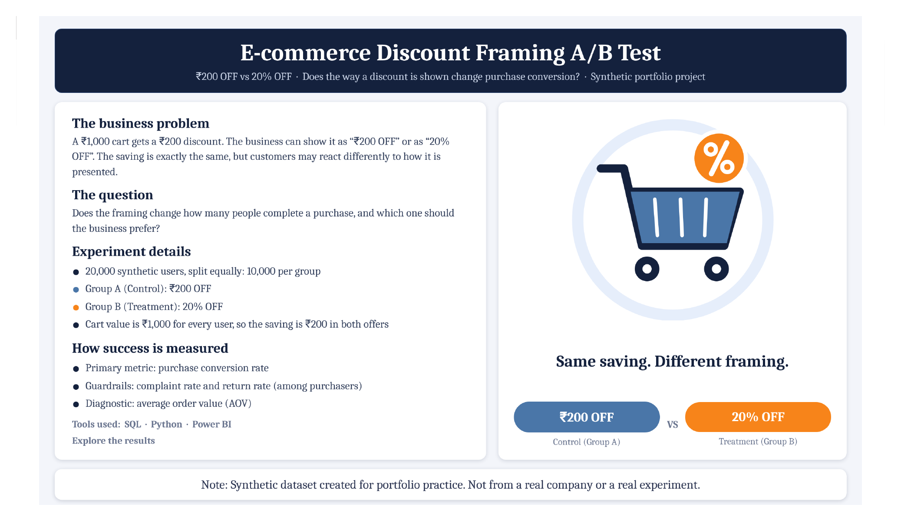
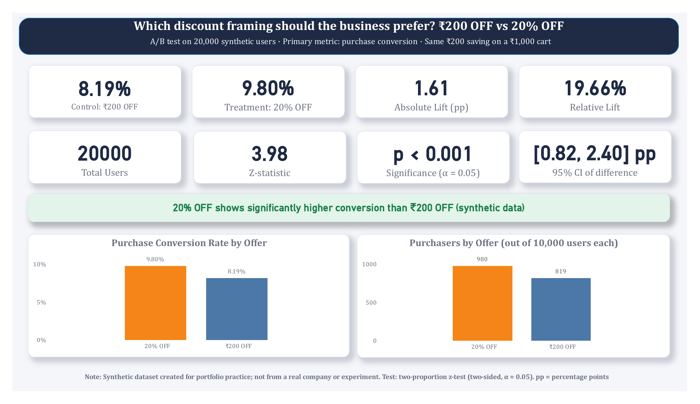
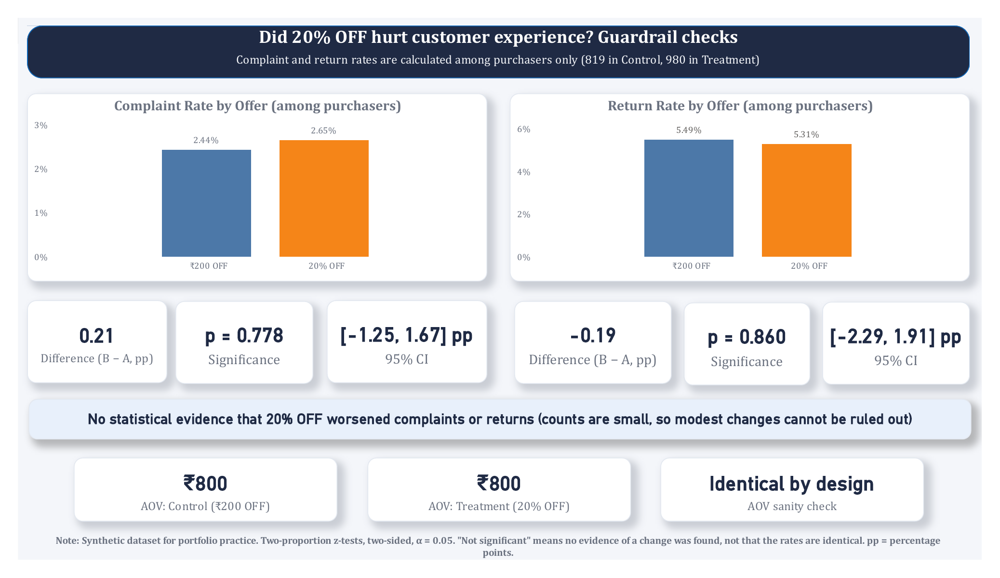
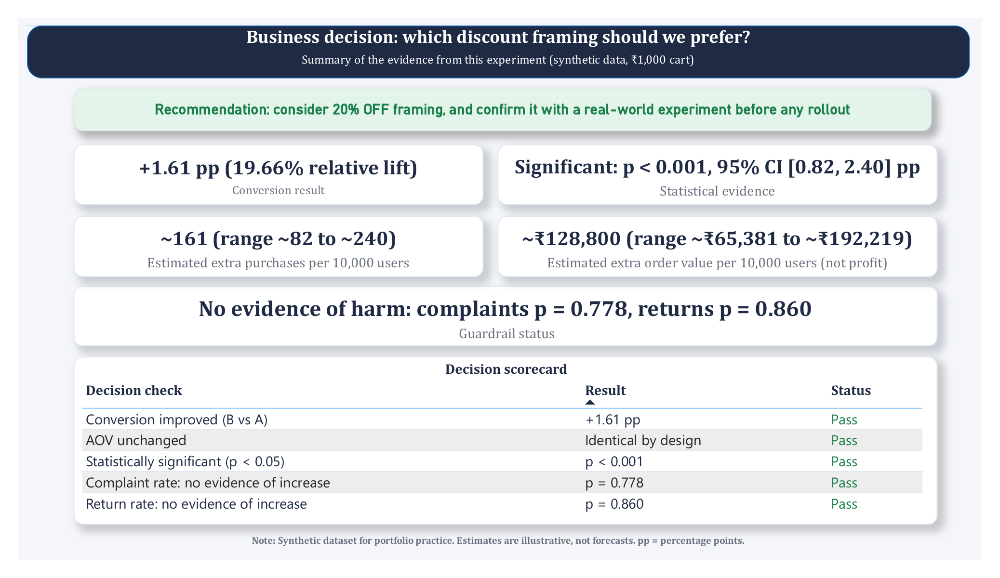

# E-commerce Discount Framing A/B Test: ₹200 OFF vs 20% OFF

> **Synthetic dataset.** This is a portfolio project built on synthetic data (20,000 simulated users). It is not from a real company, and the experiment did not actually take place. The results below describe this dataset only and are not an industry benchmark.

An end-to-end A/B testing project: **data validation → SQL → statistical testing → guardrail analysis → business decision → Power BI dashboard.**

<p align="center">
  
</p>

---

## 1. Business problem

A ₹1,000 cart gets a ₹200 discount. The business can show it in two ways:

| Group | Role | Offer shown |
|---|---|---|
| **A** | Control | **₹200 OFF** |
| **B** | Treatment | **20% OFF** |

Both offers give exactly the same saving (20% of ₹1,000 = ₹200, final order value ₹800). The experiment therefore tests **discount framing**, not discount generosity.

**Question:** does the framing change how many users complete a purchase, and which one should the business prefer?

---

## 2. Experiment design

- **Users:** 20,000 (10,000 in each group)
- **Cart value:** ₹1,000 for every user
- **Primary metric:** purchase conversion rate = purchases ÷ users × 100
- **Guardrail metrics:** complaint rate and return rate, both calculated among purchasers
- **Diagnostic:** average order value (AOV). Every completed order is ₹800 by design, so AOV is a sanity check, not a performance metric.
- **Hypotheses:** H0: conversion is the same in A and B. H1: conversion differs (two-sided).
- **Test:** two-proportion z-test, α = 0.05

## 3. Dataset

`data/ecommerce_discount_ab_test.csv` has 20,000 rows and 8 columns:

| Column | Description |
|---|---|
| `User_ID` | Unique user identifier |
| `Group` | A (control) or B (treatment) |
| `Offer` | "₹200 OFF" or "20% OFF" |
| `Cart_Value` | Cart value (₹1,000 for all users) |
| `Purchased` | 1 if the user purchased, else 0 |
| `Order_Value` | ₹800 for purchasers, 0 otherwise |
| `Complaint` | 1 if the purchaser complained, else 0 |
| `Returned` | 1 if the purchaser returned the order, else 0 |

**Validation (all passed, 0 violations):** no missing values, no duplicate users, offer matches group, a non-purchaser never has an order value, complaint or return, and every order is exactly ₹800.

---

## 4. Results

### Primary metric: purchase conversion

| | Group A (₹200 OFF) | Group B (20% OFF) |
|---|---|---|
| Users | 10,000 | 10,000 |
| Purchasers | 819 | 980 |
| **Conversion rate** | **8.19%** | **9.80%** |

- **Absolute difference:** +1.61 percentage points
- **Relative lift:** +19.66%
- **Z-test:** z = 3.98, **p = 0.000069** (< 0.05), so H0 is rejected
- **95% CI for the difference:** [0.82, 2.40] percentage points (does not include 0)

### Guardrails (among purchasers)

| Metric | Group A | Group B | Difference (pp) | 95% CI (pp) | p-value | Significant? |
|---|---|---|---|---|---|---|
| Complaint rate | 2.44% (20/819) | 2.65% (26/980) | +0.21 | [-1.25, 1.67] | 0.7776 | No |
| Return rate | 5.49% (45/819) | 5.31% (52/980) | -0.19 | [-2.29, 1.91] | 0.8602 | No |

No statistical evidence of higher complaints or returns was found. This does **not** prove the rates are identical: the counts are small and the intervals are wide, so a modest change in either direction cannot be ruled out.

### AOV sanity check
AOV is ₹800 in both groups (every order is ₹800 by design). Group B's higher total order value (₹7,84,000 vs ₹6,55,200) comes only from having more orders.

### Estimated impact (illustrative)
Per 10,000 users exposed, the observed difference corresponds to roughly **161 extra purchases** (plausible range about 82 to 240), or about **₹1,28,800** in order value. This is order value, **not profit**, and the dataset is synthetic, so the figures illustrate scale rather than forecast real results.

---

## 5. Business recommendation

In this dataset, "20% OFF" shows a statistically significant higher purchase conversion than "₹200 OFF", with no evidence of worse customer experience. The business could consider the percentage framing, but should **confirm the effect in a real experiment** (including promotion cost and margin) before any rollout.

## 6. Limitations

- Synthetic data: results do not describe any real company or customers.
- Every user had the same ₹1,000 cart. At other cart values ₹200 OFF and 20% OFF are not equal, so the result cannot be extended to them.
- Only one discount level was tested, and only conversion, complaints and returns were measured.
- One experiment, with no time dimension or customer segments, so it cannot show whether the effect lasts or differs across user types.
- Guardrail tests have low power because complaint and return counts are small.

---

## 7. Power BI dashboard

A 4-page dashboard (`dashboard/Ecommerce_Discount_AB_Test.pbix`, PDF export in the same folder). The z-test, p-value and confidence intervals are calculated with DAX measures and match the Python results.

| Experiment Overview | Guardrails |
|---|---|
|  |  |

| Business Decision |
|---|
|  |

---

## 8. Repository structure

```
ecommerce-discount-ab-test/
├── data/
│   └── ecommerce_discount_ab_test.csv
├── sql/
│   ├── 00_setup_postgres.sql              # create database and table, load CSV
│   └── 01_ab_test_analysis_postgres.sql   # validation + all metric queries
├── notebooks/
│   └── Ecommerce_Discount_AB_Test.ipynb   # validation, SQL (SQLite), z-tests, CIs
├── dashboard/
│   ├── Ecommerce_Discount_AB_Test.pbix
│   └── Ecommerce_Discount_AB_Test.pdf
├── images/                                 # dashboard screenshots
└── README.md
```

## 9. How to reproduce

**PostgreSQL** (run from the project root):
```bash
psql -U postgres -f sql/00_setup_postgres.sql
psql -U postgres -d ab_test_db -f sql/01_ab_test_analysis_postgres.sql
```

**Notebook:** open `notebooks/Ecommerce_Discount_AB_Test.ipynb` in Google Colab, upload `data/ecommerce_discount_ab_test.csv`, and run all cells. The notebook uses SQLite so it runs without a database server; the queries follow the same logic as the PostgreSQL files.

**Dashboard:** open the `.pbix` file in Power BI Desktop.

## 10. Tools used

SQL (PostgreSQL, SQLite) · Python (pandas, NumPy, statsmodels) · Power BI (DAX) · Google Colab · Git and GitHub

---

**Author:** Sneha Gupta, final-year B.Sc. Data Science student.
